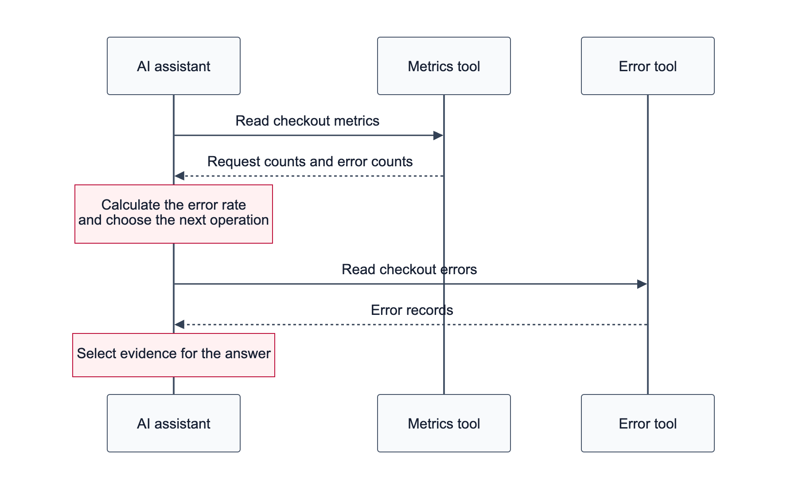
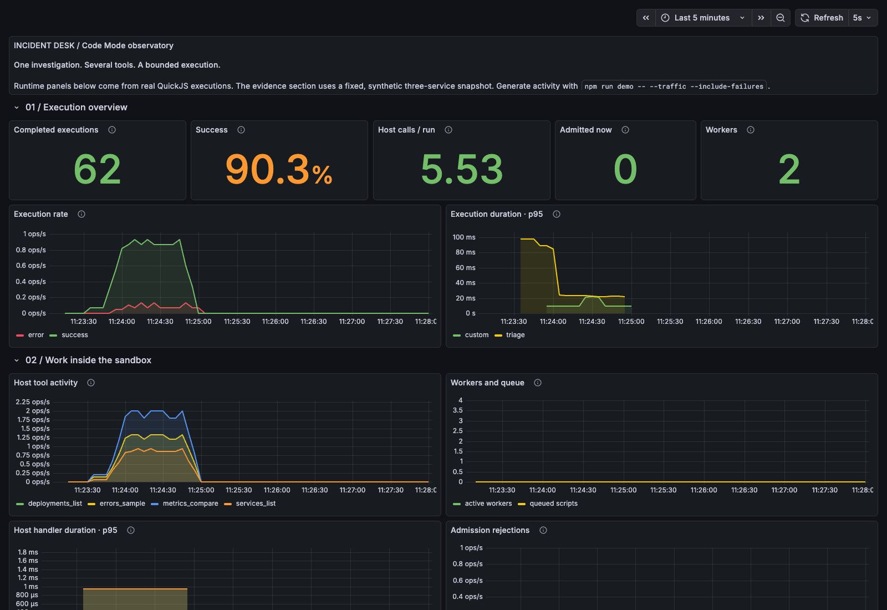
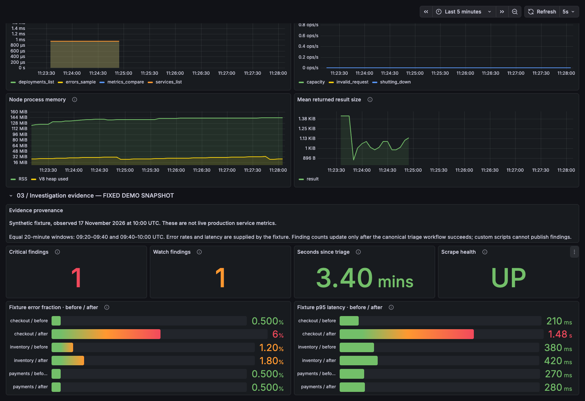
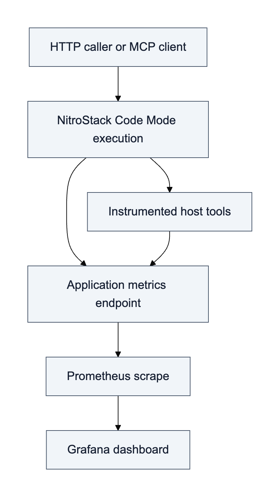

# From tool calls to Code Mode with NitroStack and Grafana

## TL;DR

- Code Mode lets an agent express part of a task as a program that calls application tools, filters results, and returns a selected value.
- Incident Desk uses four read-only tools and NitroStack's QuickJS sandbox. The canonical investigation makes eight host tool calls inside one execution.
- Prometheus and Grafana show execution duration, tool activity, failures, and worker pressure. The service records are synthetic; the execution measurements come from the running application.
- The default investigation runs a reviewed script without an LLM. A model-cost comparison requires a model integration, usage measurements, and a controlled baseline.

You asked a chat assistant how to investigate a checkout failure. It described the steps, and you opened the monitoring tools to carry them out. You chose the queries and pasted the results back into the chat.

Developers connected models to tools so assistants could take action. A model could request an order record or query a database, read the response, and choose its next step. Through that loop, an agent could work through a task on your behalf.

During an investigation, the agent could compare service behavior and read the errors following a deployment. The model coordinated repeated operations and carried their results through the conversation as the investigation grew.

Code Mode gives developers a way to move that coordination into a program. We used NitroStack to build a demonstration of the approach and connected Grafana to examine the executions.

## Agents learned to call tools

In the familiar tool-calling loop, the model chooses an operation and supplies its inputs. Your application runs the operation and sends back a result. The model reads it and chooses its next operation.

A request for the latest deployment fits that arrangement. The agent can retrieve a record and answer from it. Reviewing a release across several services takes more work: the agent needs to examine their metrics and decide which services need investigation.

You can give the agent tools for those steps. MCP, the Model Context Protocol, provides a common interface for connecting them. The agent has to coordinate their use, including the records and calculations between calls.

For example, a metrics tool might return hundreds of entries. You need a list of the services whose error rates increased. A program can calculate those rates and select the entries before the model reads the result.

That kind of work motivated developers to give agents a programming environment alongside their tools.

## The step toward Code Mode

Researchers explored code as an agent's action interface before Cloudflare's Code Mode announcement. In 2024, [CodeAct](https://proceedings.mlr.press/v235/wang24h.html) used executable Python programs to combine actions and respond to results. [Cloudflare introduced Code Mode](https://blog.cloudflare.com/code-mode/) for MCP in September 2025, and [Anthropic explored code execution with MCP](https://www.anthropic.com/research/code-execution-with-mcp) that November.

The assistant could write a program for part of its assignment. That program could use a tool's result in a calculation and choose another operation without returning to the model for each decision.

Code Mode lets an agent express a procedure in code and execute it with access to the tools you provide. For a service investigation, the procedure could compare error rates across services and collect detail for those that crossed a threshold.

The application runs the underlying tool operations. The generated program supplies the loops and decisions that connect them.

### Follow a decision between two calls

Take the part of an investigation that checks checkout errors. The assistant needs the metrics before it can decide whether to request error records. In a direct tool-calling loop, it reads the first result, makes the comparison, and requests the next operation.



The metrics and error records enter the conversation as separate results. A client can batch independent requests, but this decision depends on the metrics arriving first.

### Put the comparison inside a program

For a service review, give the assistant four tools: list services, compare metrics, retrieve deployments, and sample errors. The program below investigates a service if its error rate increased and reached at least 1%.

```javascript
const catalog = await callTool('services_list', {});
const findings = [];

for (const service of catalog.services) {
  const metrics = await callTool('metrics_compare', { service: service.id });
  const beforeRate = metrics.before.errors / metrics.before.requests;
  const afterRate = metrics.after.errors / metrics.after.requests;

  if (afterRate < 0.01 || afterRate <= beforeRate) continue;

  const deployments = await callTool('deployments_list', { service: service.id });
  const errors = await callTool('errors_sample', { service: service.id });

  findings.push({
    service: service.id,
    errorRate: afterRate,
    recentDeployments: deployments.items.length,
    errorSamples: errors.items.length,
  });
}

return findings;
```

This code runs inside Code Mode, where `callTool` requests an application tool. The loop handles one service at a time and calculates error rates from request and error counts. The `continue` line skips a service that fails the investigation rule, so the program avoids spending detail calls on it.

For a service that passes the rule, the program collects deployments and error samples. It returns the service name, its error rate, and counts of the evidence it found. Raw records stay available to the program while the model receives a shorter result:

```json
[
  {
    "service": "checkout",
    "errorRate": 0.06,
    "recentDeployments": 1,
    "errorSamples": 2
  },
  {
    "service": "inventory",
    "errorRate": 0.018,
    "recentDeployments": 0,
    "errorSamples": 1
  }
]
```

Here, `0.06` means a 6% error rate. The program examines three services and requests detail for two. That requires one catalog call, three metric comparisons, and four detail calls: eight host tool calls inside one execution.

This [runnable example](examples/code-mode-investigation.js) uses a short investigation rule to expose the control flow. The project's [complete workflow](https://github.com/satyampsoni/incident-desk/blob/dc29e52af059c0cb061fb72a227facb8960d5b4c/workflows/triage.js) adds latency checks and severity thresholds, and returns evidence for an engineer to inspect.

## The business value of moving coordination into code

An agent spends part of its available context on tool descriptions. Context is the information the model can work with during a request. A large catalog can consume a substantial share before the agent begins the user's task. Discovering the tools it needs can reduce that initial load.

Intermediate results add another cost. An agent reviewing a hundred records may carry those records through several model requests, even if the final answer needs a small subset. With Code Mode, the program can filter the records and return the relevant fields. It can pass an identifier from one tool into the next operation without asking the model to write that handoff.

You can write one error-rate calculation and apply it to the services in a list. The program can read that list a page at a time and fetch error details for services above your chosen limit.

Direct tool calling supports batching for independent operations. Code Mode extends the control developers can give an agent over the steps between operations. A single lookup offers little work to move into a program; a task with repeated calculations or dependent calls offers more.

The execution environment takes time and resources. To assess the approach in an application, you need to measure the work it performs.

For a product team, the useful outcome is completing the same investigation with a procedure it can inspect, bound, and repeat. Returning selected fields may also reduce what the model has to process. That becomes a cost benefit only when the application's measurements show it; fewer model turns can still involve the same backend operations.

## Bringing Grafana into the test

You need more than a completed answer to assess execution behavior. You need to see how long runs take, which tool operations consume time, and whether the application can accept incoming work.

Grafana lets you examine those measurements on a dashboard. Plotting duration over repeated runs helps you spot changes that one successful example would hide. Tool-activity charts let you compare the amount of work across runs, while failure counts show the executions that ended with an error.

Compare waiting work with execution time to distinguish a capacity problem from an expensive operation. A request waiting for a worker needs a different investigation from a tool taking longer to respond.

For this project, we use Grafana to examine Code Mode execution inside the application. A comparison of model cost or token usage would need provider-usage measurements alongside these runtime graphs.

## Build and observe Code Mode with NitroStack

NitroStack includes Code Mode in its MCP framework. Developers define the tools their application provides and enable Code Mode so an assistant can coordinate them through JavaScript.

An assistant uses `search` to find a tool and `get_schema` to inspect its inputs. It submits its program to `execute`, which runs the JavaScript in a sandbox, a controlled execution space with time and memory limits. Developers set a budget for tool calls.

The diagram starts after the assistant has found the tools and checked their inputs. During execution, the program makes the comparisons and chooses which operations to request.


`callTool` connects the sandbox to the application. NitroStack finds the registered tool and validates the arguments before running it. It passes the result back into the program, where the script can read it and continue. The model receives the value the program returns when it finishes.

You choose the capabilities behind that bridge. The program can use the registered tools; those tools determine which systems it can reach. In this application, the tools read service evidence. We grant no deployment-changing operation.

We built **Incident Desk** to observe that execution path. The demonstration reviews checkout, inventory, and payments services. We gave it tools to compare metrics and retrieve deployment or error records.

The investigation lists the services and compares their behavior across two windows. It requests further evidence for the services that cross the investigation thresholds. The complete workflow makes **eight tool calls inside one execution** and returns a report identifying the services that need attention.

We use a reviewed program for the default run so we can repeat the procedure while examining its behavior. An MCP client can discover the same tools and submit another investigation program. Both routes pass through the application's execution controls and measurements.

One submitted program can contain several timed tool calls. We record the duration of the whole execution and the time spent in individual tool handlers. Prometheus collects those measurements so we can examine both levels in Grafana.

### 1. Configure the execution boundary

The base SDK configuration for this example uses two workers, a three-second timeout, a 64 MiB sandbox memory limit, and a 24-call budget:

```typescript
import { CodeModeTransform, NitroStackServer } from '@nitrostack/core';

const codeMode = new CodeModeTransform({
  workerPoolSize: 2,
  timeoutMs: 3000,
  memoryLimitMb: 64,
  maxToolCalls: 24,
  allowDestructive: false,
});

const server = new NitroStackServer({
  name: 'incident-desk',
  version: '0.1.0',
  transforms: [codeMode],
});
```

This shows the core configuration, not the complete application. Incident Desk extends the transform to record executions and applies a separate maximum of four admitted runs, counting both running and waiting work. The [runtime](https://github.com/satyampsoni/incident-desk/blob/dc29e52af059c0cb061fb72a227facb8960d5b4c/src/runtime.ts) registers and instruments the four host tools.

Those limits constrain guest execution. Access to business systems is still determined by the registered host handlers. The sample handlers read a fixed service snapshot.

### 2. Run the application and monitoring stack

The [Incident Desk repository](https://github.com/satyampsoni/incident-desk) includes the application, Prometheus configuration, and a provisioned Grafana dashboard. With Docker Compose available:

```bash
git clone https://github.com/satyampsoni/incident-desk.git
cd incident-desk
docker compose up -d --build
```

Then submit the reviewed investigation:

```bash
curl --fail-with-body http://127.0.0.1:4310/api/investigate \
  -H 'Content-Type: application/json' \
  -d '{}'
```

The full workflow returns checkout as critical and inventory as watch, and omits payments from its findings. A nearby deployment is evidence to investigate; the example does not establish that the deployment caused the errors.

### 3. Generate activity for the dashboard

The helper script requires Node.js 22 or 24. From the application directory:

```bash
npm ci
npm run demo -- --traffic --include-failures --count 60
```

The generator mixes investigations with smaller programs and intentional failures. It exercises the runtime rather than measuring model reasoning. Prometheus scrapes every five seconds, so allow multiple scrapes before interpreting rate and quantile panels.

Open [the Grafana dashboard](http://127.0.0.1:4311/d/incident-desk). For installation details and the disposable Compose variant, use the application's [README](https://github.com/satyampsoni/incident-desk/blob/dc29e52af059c0cb061fb72a227facb8960d5b4c/README.md).

### 4. Read the measurements alongside the findings


Start with the completed-run count and success rate. They show how much work has finished and the proportion that completed without an execution error. The calls-per-run panel helps you check how much tool activity each submitted program produced.



The traffic generator submits full investigations and smaller scripts, so the dashboard's average covers different amounts of work. Compare like workloads before attributing a change in duration to the runtime.

The duration graph includes a p95 line. It estimates the duration within which 95% of the observed executions finish, helping you examine slower runs that an average can hide. Read it alongside tool durations and waiting work.

Rising tool durations give you a reason to inspect the underlying operations. A growing queue with stable tool durations gives you a reason to examine execution capacity. Neither pattern proves a cause, but both help you choose where to investigate.

We submit scripts that throw errors to exercise the failure path. You can see those executions in the failure count and run history. We test timeout recovery so a failed script does not prevent the next investigation from completing.

The lower dashboard section contains the service comparisons and findings for the example investigation.



You can examine the evidence in the report and inspect the execution that produced it. The panel labels distinguish the example service values from measurements of the Code Mode runtime.

For example, this PromQL expression estimates p95 duration for the canonical triage workflow over a five-minute window:

```promql
histogram_quantile(
  0.95,
  sum by (le) (
    rate(incident_desk_run_duration_seconds_bucket{workflow="triage"}[5m])
  )
)
```

The histogram includes sandbox queue wait. It needs recent observations, and its quantile is an estimate based on the configured buckets. Filtering to one workflow avoids combining the canonical investigation with smaller custom programs.

The telemetry path is:



[Diagram source](assets/execution-telemetry.mmd) · [SVG](assets/execution-telemetry.svg)

### 5. Connect an AI client when testing generated programs

To let a model choose and write a workflow, connect an MCP client using the application's [stdio instructions](https://github.com/satyampsoni/incident-desk/blob/dc29e52af059c0cb061fb72a227facb8960d5b4c/README.md#local-development-and-mcp). That starts a separate process. Add its metrics endpoint as a Prometheus scrape target if you want Grafana to observe that process; the default dashboard targets the container application.

For a comparison with direct tool calling, keep the task, model, data, and success criteria consistent. Record provider usage as well as runtime measurements. The [decision record](https://github.com/satyampsoni/incident-desk/blob/dc29e52af059c0cb061fb72a227facb8960d5b4c/DECISIONS.md) explains the example's boundaries.

## Frequently asked questions

### What is Code Mode?

It is an approach where an agent writes a program to coordinate tools. The program can loop over results, perform calculations, and choose dependent operations before returning a value to the model.

### Does one Code Mode execution mean one backend call?

No. The example makes eight host tool calls inside one execution. Moving coordination into code can change the interaction with the model while preserving the underlying work needed to answer the question.

### Does Code Mode always cost less than direct tool calling?

No. The runtime has overhead, and a direct client can already batch independent operations. Compare representative tasks, their success rates, total duration, provider usage, and backend activity before making a cost claim.

### Do I need an LLM key to run Incident Desk?

No. The default investigation submits a reviewed program. An AI client is needed when you want a model to discover tools and generate a program. Those are different ways of entering the same execution pipeline.

### Are the Grafana charts showing production incidents?

The incident data is a fixed synthetic snapshot. Execution duration, tool calls, failures, and runtime metrics come from actual application runs. The dashboard labels the evidence and runtime sections separately.

### Does Grafana establish that an agent's answer is correct?

No. It displays the measurements you provide. Execution success means the program completed without an execution error. Correctness requires expected results, application tests, or task-level evaluations in addition to runtime monitoring.

### What can a guest program access?

In this example, it can call the four registered read-only tools through `callTool`. It has no direct Node.js filesystem, process, or network APIs. Host tools define the reachable systems, so their authorization, input validation, and resource limits remain part of the application design.
