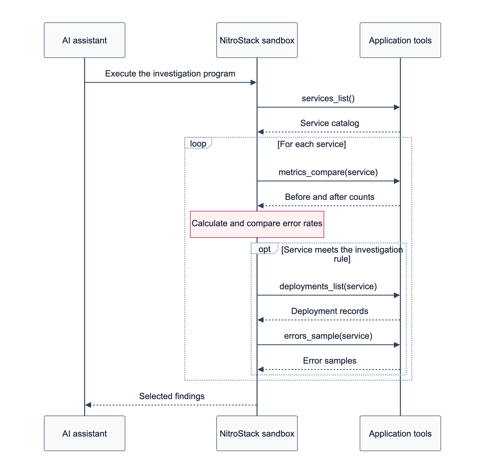

# From tool calls to Code Mode with NitroStack and Grafana

## TL;DR

- Code Mode lets an agent express part of a task as a program that calls application tools, filters results, and returns a selected value.
- NitroStack supplies the execution boundary; host tools control access to metrics, deployment records, and logs.
- Prometheus and Grafana expose execution duration, tool activity, failures, and worker pressure so operators can investigate the workflow itself.
- A production deployment needs scoped backend access, deadlines, admission control, and an audit trail. Assess cost and performance against the same workload and success criteria.

A checkout investigation can cross several systems before an engineer has enough information to act: service metrics, deployment history, and application logs. An agent needs to follow the same trail, including the comparisons and decisions between those queries.

If the model coordinates every step, each intermediate result becomes another input it has to interpret. Code Mode lets the agent express part of that investigation as a program. The program can compare services, select the ones that need attention, and retrieve further evidence through application tools.

Operating that workflow introduces another responsibility: observing the execution that is doing the investigating. A slow run might be waiting for a sandbox worker, blocked on a metrics backend, or processing more records than its budget allows.

This article develops that production architecture using NitroStack for tool execution and Grafana for runtime visibility. Incident Desk provides the reference implementation used in the walkthrough.

## Agents learned to call tools

In the familiar tool-calling loop, the model chooses an operation and supplies its inputs. Your application runs the operation and sends back a result. The model reads it and chooses its next operation.

A request for the latest deployment fits that arrangement. The agent can retrieve a record and answer from it. Reviewing a release across several services takes more work: the agent needs to examine their metrics and decide which services need investigation.

You can give the agent tools for those steps. MCP, the Model Context Protocol, provides a common interface for connecting them. The agent has to coordinate their use, including the records and calculations between calls.

For example, a metrics tool might return hundreds of entries. You need a list of the services whose error rates increased. A program can calculate those rates and select the entries before the model reads the result.

That kind of work motivated developers to give agents a programming environment alongside their tools.

## The step toward Code Mode

Researchers explored code as an agent's action interface before Cloudflare's Code Mode announcement. In 2024, [CodeAct](https://proceedings.mlr.press/v235/wang24h.html) used executable Python programs to combine actions and respond to results. [Cloudflare introduced Code Mode](https://blog.cloudflare.com/code-mode/) for MCP in September 2025, and [Anthropic explored code execution with MCP](https://www.anthropic.com/research/code-execution-with-mcp) that November.

The assistant could write a program for part of its assignment. That program could use a tool's result in a calculation and choose another operation without returning to the model for each decision.

Code Mode lets an agent express a procedure in code and execute it with access to the tools you provide. For a service investigation, the procedure could compare error rates across services and collect detail for those that crossed a threshold.

The application runs the underlying tool operations. The generated program supplies the loops and decisions that connect them.

### Follow a decision between two calls

Take the part of an investigation that checks checkout errors. The assistant needs the metrics before it can decide whether to request error records. In a direct tool-calling loop, it reads the first result, makes the comparison, and requests the next operation.


The metrics and error records enter the conversation as separate results. A client can batch independent requests, but this decision depends on the metrics arriving first.

### Put the comparison inside a program

For a service review, give the assistant four tools: list services, compare metrics, retrieve deployments, and sample errors. The program below investigates a service if its error rate increased and reached at least 1%.

```javascript
const catalog = await callTool('services_list', {});
const findings = [];

for (const service of catalog.services) {
  const metrics = await callTool('metrics_compare', { service: service.id });
  const beforeRate = metrics.before.errors / metrics.before.requests;
  const afterRate = metrics.after.errors / metrics.after.requests;

  if (afterRate < 0.01 || afterRate <= beforeRate) continue;

  const deployments = await callTool('deployments_list', { service: service.id });
  const errors = await callTool('errors_sample', { service: service.id });

  findings.push({
    service: service.id,
    errorRate: afterRate,
    recentDeployments: deployments.items.length,
    errorSamples: errors.items.length,
  });
}

return findings;
```

This code runs inside Code Mode, where `callTool` requests an application tool. The loop handles one service at a time and calculates error rates from request and error counts. The `continue` line skips a service that fails the investigation rule, so the program avoids spending detail calls on it.

For a service that passes the rule, the program collects deployments and error samples. It returns the service identifier, calculated error rate, and counts of the supporting records. The output depends on the observations returned by the tools; the program does not need to send every intermediate record back to the model.

The 1% threshold illustrates the control flow. In an operational policy, use thresholds appropriate to the service and handle low-traffic or empty windows explicitly. The example's input contract requires nonzero request counts. Keep the comparison windows and observation times with a finding so an engineer can reproduce the calculation.

This [runnable example](examples/code-mode-investigation.js) uses a short investigation rule to expose the control flow. The project's [complete workflow](https://github.com/satyampsoni/incident-desk/blob/dc29e52af059c0cb061fb72a227facb8960d5b4c/workflows/triage.js) adds latency checks and severity thresholds, and returns evidence for an engineer to inspect.

## The business value of moving coordination into code

An agent spends part of its available context on tool descriptions. Context is the information the model can work with during a request. A large catalog can consume a substantial share before the agent begins the user's task. Discovering the tools it needs can reduce that initial load.

Intermediate results add another cost. An agent reviewing a hundred records may carry those records through several model requests, even if the final answer needs a small subset. With Code Mode, the program can filter the records and return the relevant fields. It can pass an identifier from one tool into the next operation without asking the model to write that handoff.

You can write one error-rate calculation and apply it to the services in a list. The program can read that list a page at a time and fetch error details for services above your chosen limit.

Direct tool calling supports batching for independent operations. Code Mode extends the control developers can give an agent over the steps between operations. A single lookup offers little work to move into a program; a task with repeated calculations or dependent calls offers more.

The execution environment takes time and resources. To assess the approach in an application, you need to measure the work it performs.

For a product team, the useful outcome is completing the same investigation with a procedure it can inspect, bound, and repeat. Returning selected fields may also reduce what the model has to process. That becomes a cost benefit only when the application's measurements show it; fewer model turns can still involve the same backend operations.

## Observing the investigation in Grafana

You need more than a completed answer to assess execution behavior. You need to see how long runs take, which tool operations consume time, and whether the application can accept incoming work.

Grafana lets you examine those measurements on a dashboard. Plotting duration over repeated runs helps you spot changes that one successful example would hide. Tool-activity charts let you compare the amount of work across runs, while failure counts show the executions that ended with an error.

Compare waiting work with execution time to distinguish a capacity problem from an expensive operation. A request waiting for a worker needs a different investigation from a tool taking longer to respond.

For this project, we use Grafana to examine Code Mode execution inside the application. A comparison of model cost or token usage would need provider-usage measurements alongside these runtime graphs.

Keep runtime telemetry separate from the service signals being investigated. The runtime may be available while a downstream metrics query is failing. A useful dashboard gives operators a view of both the workload and its dependencies:

| Signal | Operational use |
| --- | --- |
| Execution duration by workflow | Detect slower investigations and compare equivalent work |
| Host-tool duration and errors | Locate a metrics, logging, or deployment dependency that needs attention |
| Admitted runs, active workers, and queue | Separate execution pressure from backend latency |
| Rejections and deadline failures | Check whether demand and configured budgets match |
| Returned result size and tool activity | Identify workflows that collect more data than intended |

Use stable, bounded dimensions such as workflow and tool name for metrics. Put run identifiers and detailed evidence references in logs or traces rather than creating a time series for every investigation. [Prometheus label guidance](https://prometheus.io/docs/practices/naming/)

## Build and observe Code Mode with NitroStack

NitroStack includes Code Mode in its MCP framework. Developers define the tools their application provides and enable Code Mode so an assistant can coordinate them through JavaScript.

An assistant uses `search` to find a tool and `get_schema` to inspect its inputs. It submits its program to `execute`, which runs the JavaScript in a sandbox, a controlled execution space with time and memory limits. Developers set a budget for tool calls.

The diagram starts after the assistant has found the tools and checked their inputs. During execution, the program makes the comparisons and chooses which operations to request.



`callTool` connects the sandbox to the application. NitroStack finds the registered tool and validates the arguments before running it. It passes the result back into the program, where the script can read it and continue. The model receives the value the program returns when it finishes.

You choose the capabilities behind that bridge. The program can use the registered tools; those tools determine which systems it can reach. In this application, the tools read service evidence. We grant no deployment-changing operation.

Incident Desk implements that execution path with four tool contracts: list services, compare metrics, retrieve deployments, and sample errors. The investigation requests further evidence only for services that cross its thresholds.

For reproducibility, the repository runs a reviewed program against a fixed synthetic incident dataset. Its screenshots show actual runtime executions over that dataset. Treat it as a reference implementation; connect the host handlers to your observability systems before applying the workflow to production incidents.

One submitted program can contain several timed tool calls. We record the duration of the whole execution and the time spent in individual tool handlers. Prometheus collects those measurements so we can examine both levels in Grafana.

### 1. Connect the host tools to your observability systems

Keep the tool interface focused on the operation the investigation needs. The backend adapter owns credentials, scope checks, query construction, and data limits.

| Tool | Production data source | Contract to enforce |
| --- | --- | --- |
| `services_list` | Service catalog or ownership registry | Return only services in the caller's permitted environment and scope |
| `metrics_compare` | Prometheus or your metrics platform | Use comparable windows, include observation times, and define empty-window behavior |
| `deployments_list` | Release platform or deployment event store | Scope by service and time range; bound the returned records |
| `errors_sample` | Log platform such as Loki | Restrict the query, redact sensitive fields, and cap records and response size |

Replace the four host handlers in the [runtime](https://github.com/satyampsoni/incident-desk/blob/dc29e52af059c0cb061fb72a227facb8960d5b4c/src/runtime.ts) with these adapters. The reference repository does not include the live integrations in this table. Document any contract extensions, including freshness metadata, before changing the investigation program.

Set an independent deadline on backend I/O and propagate cancellation where the client supports it. A sandbox deadline should not leave an unbounded database or logging query running after the guest program stops.

### 2. Configure the execution boundary

The base SDK configuration for this example uses two workers, a three-second timeout, a 64 MiB sandbox memory limit, and a 24-call budget:

```typescript
import { CodeModeTransform, NitroStackServer } from '@nitrostack/core';

const codeMode = new CodeModeTransform({
  workerPoolSize: 2,
  timeoutMs: 3000,
  memoryLimitMb: 64,
  maxToolCalls: 24,
  allowDestructive: false,
});

const server = new NitroStackServer({
  name: 'incident-desk',
  version: '0.1.0',
  transforms: [codeMode],
});
```

This shows the core configuration, not the complete application. Incident Desk extends the transform to record executions and applies a separate maximum of four admitted runs, counting both running and waiting work. The [runtime](https://github.com/satyampsoni/incident-desk/blob/dc29e52af059c0cb061fb72a227facb8960d5b4c/src/runtime.ts) registers and instruments the four host tools.

Choose production limits from measured workload duration and backend capacity. Worker count, admission limits, and tool-call budgets protect different resources; increasing one can move pressure into another part of the system.

### 3. Run the reference stack and exercise the execution path

The [Incident Desk repository](https://github.com/satyampsoni/incident-desk) includes the application, Prometheus configuration, and a provisioned Grafana dashboard. With Docker Compose available:

```bash
git clone https://github.com/satyampsoni/incident-desk.git
cd incident-desk
docker compose up -d --build
```

Then submit the reviewed investigation:

```bash
curl --fail-with-body http://127.0.0.1:4310/api/investigate \
  -H 'Content-Type: application/json' \
  -d '{}'
```

Inspect the returned findings alongside their comparison windows and supporting records. Temporal proximity to a deployment is a lead to investigate, not proof of a cause.

The helper script requires Node.js 22 or 24. From the application directory:

```bash
npm ci
npm run demo -- --traffic --include-failures --count 60
```

The generator mixes investigations with smaller programs and intentional failures. It exercises the runtime rather than measuring model reasoning. Prometheus scrapes every five seconds, so allow multiple scrapes before interpreting rate and quantile panels.

Open [the Grafana dashboard](http://127.0.0.1:4311/d/incident-desk). For installation details and the disposable Compose variant, use the application's [README](https://github.com/satyampsoni/incident-desk/blob/dc29e52af059c0cb061fb72a227facb8960d5b4c/README.md).

### 4. Read the runtime measurements

Start with the completed-run count and success rate. They show how much work has finished and the proportion that completed without an execution error. The calls-per-run panel helps you check how much tool activity each submitted program produced.

Segment the dashboard by workflow before interpreting averages. A short lookup and an investigation that crosses several services perform different amounts of work. Correlate a change in duration with the deployed program version and backend activity.

The duration graph includes a p95 line. It estimates the duration within which 95% of the observed executions finish, helping you examine slower runs that an average can hide. Read it alongside tool durations and waiting work.

Rising tool durations give you a reason to inspect the underlying operations. A growing queue with stable tool durations gives you a reason to examine execution capacity. Neither pattern proves a cause, but both help you choose where to investigate.

Exercise dependency failures, rejected work, and timeouts during validation. Check that a failed script releases its capacity and that the next investigation can complete. Inspect rejection counters separately from failures in work that was already admitted.

In a deployed workflow, link a run to the service queries and observation windows that produced its findings. Preserve the correlation outside metric labels so operators can move from a graph to the relevant execution record.

For example, this PromQL expression estimates p95 duration for the canonical triage workflow over a five-minute window:

```promql
histogram_quantile(
  0.95,
  sum by (le) (
    rate(incident_desk_run_duration_seconds_bucket{workflow="triage"}[5m])
  )
)
```

The histogram includes sandbox queue wait. It needs recent observations, and its quantile is an estimate based on the configured buckets. Filtering to one workflow avoids combining the canonical investigation with smaller custom programs.

The telemetry path is:


[Diagram source](assets/execution-telemetry.mmd) · [SVG](assets/execution-telemetry.svg)

### 5. Route generated programs through the same controls

To let a model choose and write a workflow, connect an MCP client using the application's [stdio instructions](https://github.com/satyampsoni/incident-desk/blob/dc29e52af059c0cb061fb72a227facb8960d5b4c/README.md#local-development-and-mcp). That starts a separate process. Add its metrics endpoint as a Prometheus scrape target if you want Grafana to observe that process; the default dashboard targets the container application.

For a comparison with direct tool calling, keep the task, model, data, and success criteria consistent. Record provider usage as well as runtime measurements. The [decision record](https://github.com/satyampsoni/incident-desk/blob/dc29e52af059c0cb061fb72a227facb8960d5b4c/DECISIONS.md) explains the example's boundaries.

## Frequently asked questions

### How does this connect to an existing observability stack?

Implement the host tools as adapters to your service catalog, metrics platform, deployment records, and log store. Preserve their schemas and define the allowed environment, time range, freshness, and maximum response size. The guest program works against those contracts while backend credentials stay in the host.

### How should execution limits be chosen?

Measure representative investigations under expected concurrency, then set limits around their latency objectives and backend quotas. A script deadline bounds one execution, admission control bounds accepted work, and a tool-call budget bounds the procedure's fan-out. Test saturation and recovery before increasing worker capacity.

### What should happen when a tool times out or returns incomplete data?

Give each backend request a deadline and distinguish a failed query from an empty result. Either stop the investigation or return an explicitly incomplete report, according to the workflow's policy. Do not turn missing evidence into a healthy-service finding. The illustrated program stops when a required tool call fails.

### Where should service and tenant access be enforced?

Enforce it in the host tool and downstream data system using the authenticated caller's permissions. Validate every call, including calls made inside a program, and scope query construction on the server. Tool descriptions and model instructions do not grant or enforce access.

### Can an investigation make changes to production systems?

Only if the host exposes tools that can make those changes. Keep investigation and remediation capabilities separate, require approval where the operation demands it, and design writes for retries and duplicate requests. A Code Mode program is not a transaction across its tool calls, so failure does not automatically undo earlier changes.

### How should an execution be investigated after a failure?

Correlate the run with its program hash or version, tool outcomes, backend queries, observation windows, and authorized scope. Persist the records needed for your retention policy, with sensitive content redacted. The reference application keeps a bounded in-memory run history; durable audit storage is a production integration to add.

### How do you assess whether Code Mode improves cost or latency?

Run the same task against the same data and model settings using both approaches. Compare completion criteria, end-to-end duration, provider usage, backend calls, and returned data volume. Include sandbox overhead and failed attempts. Combining calls in a program does not eliminate the underlying backend operations.

### How should a workflow change be rolled out?

Version the program and its tool contracts, check expected outcomes on representative cases, and test behavior under missing data, dependency failures, and capacity pressure. Start with a limited traffic share and monitor duration, rejection, and failure signals against the baseline. Keep a path back to the previous workflow version.
