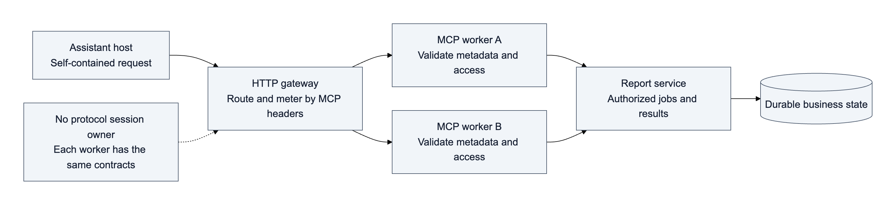
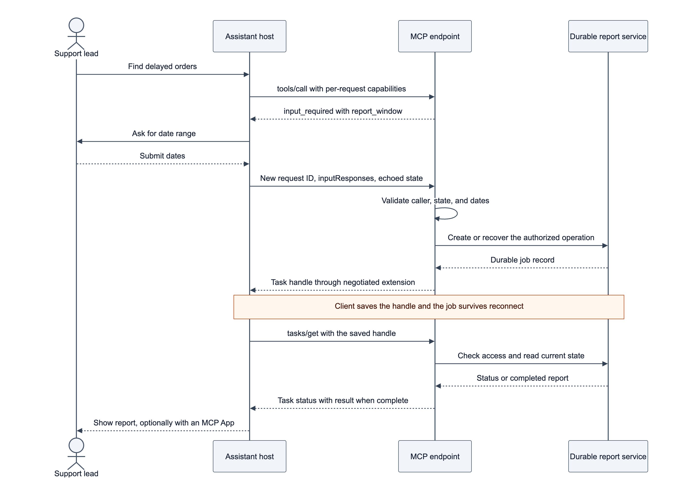
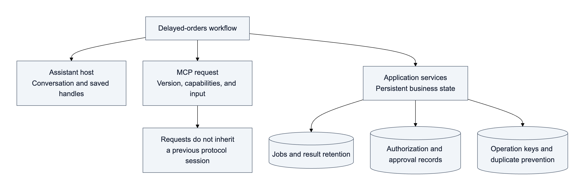

# MCP 2.0 Is Here: What Changed in the Model Context Protocol

## TL;DR

- The `2026-07-28` MCP specification removes the initialization handshake and protocol-level sessions. Requests carry their version and client capabilities, so compatible workers can process them independently.
- HTTP headers expose the method and relevant tool or resource name to gateways. The server must check that these headers agree with the request body.
- Multi Round-Trip Requests, or MRTR, let an operation ask for missing input and continue through a new request. Tasks provide a separate extension for work that needs a durable handle and later status checks.
- Streaming remains available. Progress belongs to the running request; change notifications use explicit subscriptions. The previous SSE replay mechanism is removed.
- Cache hints, authorization changes, and an extensions framework give integrations clearer contracts. They still require correct access checks, client support, and application storage.
- A production migration includes compatibility tests, rate limits, retry controls, and durable business operations. NitroStack provides a protocol and tool layer to build those integrations.

A support lead asks an AI assistant for a report of delayed orders. The assistant finds the reporting tool, but the request has no date range. It needs to ask a question before it can begin.

Once the dates are confirmed, the report takes several minutes to generate. The support lead closes the app, joins a meeting, and returns later expecting the same report to be waiting.

From the employee's perspective, this is one task. For the engineers building it, there are several lifetimes to manage: a conversation, an HTTP request, a human response, a background job, and the report itself.

Keeping all of them attached to one open connection makes the workflow harder to operate. A replaced worker or a dropped stream can leave the client unsure whether to wait, reconnect, or start again.

The MCP `2026-07-28` update changes how those interactions fit together. Requests stand on their own, missing input has an explicit response pattern, and long-running work can have an identity that outlives a connection. The report is a useful way to understand what those changes mean in production. [MCP release announcement](https://blog.modelcontextprotocol.io/posts/2026-07-28/)

## How MCP reached this point

The Model Context Protocol gives AI applications a shared way to use external tools, resources, and prompts. An assistant host contains the client that communicates with an MCP server. That server exposes capabilities such as searching company documents, reading an order, or generating a report.

Anthropic introduced MCP in November 2024 to reduce the need for a separate integration approach for every assistant and data source. The protocol's history starts before the 2025 growth in agent tooling. [MCP introduction](https://www.anthropic.com/news/model-context-protocol)

Earlier revisions began with an `initialize` exchange. The parties established their protocol version and capabilities before ordinary operations. Streamable HTTP could also issue an `Mcp-Session-Id` that subsequent calls carried back.

Session IDs were optional in those HTTP revisions, so stateless server implementations already existed. The 2026 change goes further: it removes initialization and protocol sessions from the request model itself. [Earlier HTTP session rules](https://modelcontextprotocol.io/specification/2025-11-25/basic/transports)

When a deployment kept session information in one worker, routing and recovery had to preserve access to it. Sticky routing and shared session stores were ways to meet that requirement. Removing the protocol dependency lets the reporting service choose workers based on available capacity, provided they share the required application services and configuration.

Conversation memory and report storage can now follow the business workflow and its retention requirements without depending on a transport session.

## Each request carries the information needed to interpret it

In revision `2026-07-28`, a client sends its protocol version and capabilities in the request's `params._meta`. Client name and version should also be included, but that identity is self-reported information for diagnostics, not an authenticated employee identity.

A request can therefore describe the protocol it speaks and the interactions its client supports without relying on an earlier handshake. Unsupported versions produce an error that identifies the server's supported versions. [Versioning and compatibility](https://modelcontextprotocol.io/specification/2026-07-28/basic/versioning)

For the delayed-orders report, the first HTTP request could look like this:

```http
POST /mcp HTTP/1.1
Host: reports.example.com
Authorization: Bearer <access-token>
Content-Type: application/json
Accept: application/json, text/event-stream
MCP-Protocol-Version: 2026-07-28
Mcp-Method: tools/call
Mcp-Name: report_delayed_orders

{
  "jsonrpc": "2.0",
  "id": "report-1",
  "method": "tools/call",
  "params": {
    "name": "report_delayed_orders",
    "arguments": { "operationId": "report-operation-42" },
    "_meta": {
      "io.modelcontextprotocol/protocolVersion": "2026-07-28",
      "io.modelcontextprotocol/clientInfo": {
        "name": "support-assistant",
        "version": "1.0.0"
      },
      "io.modelcontextprotocol/clientCapabilities": {
        "elicitation": { "form": {} },
        "extensions": { "io.modelcontextprotocol/tasks": {} }
      }
    }
  }
}
```

This is an illustrative exchange for the reporting workflow. The [complete request body](examples/report-request.json) is included with the article. `operationId` is an application field used to identify the intended report operation; MCP does not define it or give it permissions.

The declared capabilities matter. This client says it can collect form input and handle Tasks results. A real client must implement those interactions before advertising them. The bearer token, validated for this service, supplies the authority that the client name cannot provide.

The host can optionally call `server/discover` to learn the server's supported versions, capabilities, and identity before starting. Servers must implement discovery; clients are free to invoke a known operation directly. `tools/list` remains the way to inspect the tool catalog. [Server discovery](https://modelcontextprotocol.io/specification/2026-07-28/server/discover)

## HTTP infrastructure can see the operation

The reporting endpoint may serve inexpensive lookups as well as costly report generation. A gateway needs to distinguish them before deciding which worker pool or quota applies.

The new HTTP binding carries that information in standard headers. `Mcp-Method` identifies the JSON-RPC method. `Mcp-Name` mirrors the tool name for `tools/call`, the resource URI for `resources/read`, or the prompt name for `prompts/get`. It is required for those operations, rather than for every request. `MCP-Protocol-Version` must agree with the version in the body.

That allows routing and metering without parsing the JSON payload. The server must still reject header/body disagreement; a client cannot label an expensive report as a cheap lookup and have the body executed under the wrong contract. [Streamable HTTP headers and validation](https://modelcontextprotocol.io/specification/2026-07-28/basic/transports/streamable-http)



[Diagram source](assets/stateless-routing.mmd) · [SVG](assets/stateless-routing.svg)

For the service owner, this creates a place to separate report capacity from interactive lookups. It also makes tool-level traffic easier to measure. Worker selection no longer needs to recover the client's protocol session before deciding where the call belongs.

The gateway's decision does not authorize access to order records. Each worker still validates the caller and enforces the report's data scope.

## Missing input becomes a result the client can handle

The first report request has an operation identifier but no dates. The server needs information from the support lead.

Results now identify their shape through `resultType`: ordinary results use `"complete"`, while MRTR uses `"input_required"` when the operation needs more information. Clients interoperating with earlier servers treat a missing discriminator as `"complete"`. [Result types](https://modelcontextprotocol.io/specification/2026-07-28/basic/index)

The input-required result contains input requests and may contain an opaque `requestState` for the client to return later. In this example, it asks for a form:

```json
{
  "jsonrpc": "2.0",
  "id": "report-1",
  "result": {
    "resultType": "input_required",
    "inputRequests": {
      "report_window": {
        "method": "elicitation/create",
        "params": {
          "mode": "form",
          "message": "Which date range should the delayed-orders report cover?",
          "requestedSchema": {
            "type": "object",
            "properties": {
              "startDate": { "type": "string", "format": "date" },
              "endDate": { "type": "string", "format": "date" }
            },
            "required": ["startDate", "endDate"]
          }
        }
      }
    },
    "requestState": "opaque-server-issued-continuation"
  }
}
```

The host collects the dates and retries the original operation with `inputResponses` keyed by `report_window`. It echoes the state exactly and uses a new JSON-RPC request ID. The [follow-up request](examples/report-resume.json) includes the full metadata and answer. The continuation string shown here represents server-issued state, not an example of its cryptographic implementation. [MRTR request rules](https://modelcontextprotocol.io/specification/2026-07-28/basic/patterns/mrtr)

The server no longer sends a separate JSON-RPC request back over a held-open stream. Its request for information lives inside the result of the client's operation. This is a stronger change than merely requiring reverse requests to be associated with an active call.

For the support lead, the experience can still be a date picker in the conversation. For the server, the waiting period no longer requires a suspended report handler. Another eligible worker can process the follow-up.

Elicitation is the user-input interaction within this pattern. The host must let the person review the answer and distinguish acceptance, refusal, and cancellation. A model filling in a plausible date is different from the user submitting one. An approval workflow needs the same distinction, with approval enforced against the exact action. Form elicitation must not collect passwords or access tokens; sensitive interactions belong in the appropriate out-of-band flow. [Elicitation behavior](https://modelcontextprotocol.io/specification/2026-07-28/client/elicitation)

Returned state travels through an untrusted client. Protect state that influences business behavior, bind it to the caller and operation, and expire it. A signature can reveal tampering; single-use requirements and duplicate prevention still need server-side enforcement.

## Tasks let the report outlive the connection

The dates arrive, access checks pass, and the report is ready to run. This time the missing ingredient is time: the underlying reporting query will not finish within an ordinary interactive request.

The Tasks extension lets a supporting server return `resultType: "task"` with a task handle instead of holding the original request open. The client saves the handle and polls `tasks/get`, respecting the suggested polling interval. Completed results or errors arrive with terminal task state. If the task needs more input, the client can supply it through `tasks/update`. This replaces the earlier experimental Tasks flow, including the blocking `tasks/result` approach. [Tasks extension](https://modelcontextprotocol.io/extensions/tasks/overview)

Now the support lead can close the app. On return, the host loads the saved handle and checks the same report. It should not submit a fresh generation request merely because the conversation view was reopened.



[Diagram source](assets/report-lifecycle.mmd) · [SVG](assets/report-lifecycle.svg)

The distinction between MRTR and Tasks is useful here. MRTR handles the exchange needed to obtain input. Tasks provide the lifecycle for background work. A task can itself need input, but a date question does not automatically need to become a durable task.

Durability is an implementation responsibility behind the handle. Persist task records, their binding to the reporting job, ownership, and retained results before acknowledging work. An in-memory map cannot survive worker replacement just because its identifier is called a task ID.

Status reads must enforce access too. Knowing a handle cannot be enough to retrieve another tenant's report. Define retention and expiry so a returning user gets a meaningful response when an old result is no longer available.

The [polling example](examples/task-poll.json) shows the request shape. It needs the actual task ID returned by a Tasks-enabled server. An ordinary application job ID is a separate contract.

## Streaming and subscriptions have different jobs

Some operations finish quickly enough to stay attached to their request while emitting progress. Streamable HTTP still supports a request-scoped SSE response for that purpose.

Changes that concern the server or its resources have a separate channel. A client opens `subscriptions/listen` and asks for the notification types it needs, such as tool-list changes or updates to selected resource URIs. The server acknowledges the supported filter and tags notifications with the subscription identifier. [Subscriptions](https://modelcontextprotocol.io/specification/2026-07-28/basic/patterns/subscriptions)

For the reporting assistant, a progress message describes the report currently running. A tool-list notification says the catalog may need refreshing. Treating these as different events makes it easier to update the right part of the client.

Stream recovery changes as well. The revision removes SSE event replay through `Last-Event-ID`. A broken response stream cannot resume from its last delivered message; a fresh request needs a new JSON-RPC ID. Closing a request's SSE response also signals cancellation, although work or side effects may already have occurred. [HTTP streaming and cancellation](https://modelcontextprotocol.io/specification/2026-07-28/basic/transports/streamable-http)

A lost connection therefore needs an application decision. Check a durable task or operation record when one exists. Reopening the interface must not silently regenerate a report or repeat a consequential action.

## Optional extensions add interfaces and workflow knowledge

The core protocol does not require every host to render a chart or manage a background job. Extensions let clients and servers declare the additional behavior they support through their capabilities.

The client sends its extensions map on each request; the server advertises its extensions through discovery. Both sides must support the relevant contract. Extension lifecycle stages also matter: experimental and beta capabilities can evolve differently from stable ones. Pin the contracts your integration supports. [Extensions framework](https://modelcontextprotocol.io/extensions/overview)

For the report, MCP Apps can provide a chart inside a supporting host. The tool describes a UI resource, and the host retrieves and renders it with controlled access to host capabilities. A plain client still needs a useful structured or textual report. An inline interface should improve exploration without becoming the only way to understand the result. [MCP Apps](https://modelcontextprotocol.io/extensions/apps/overview)

Skills over MCP address another part of the workflow: knowing how the reporting service should be used. A skill might explain the company's definition of a delayed order, the checks to perform before an export, and how to interpret the result.

The Skills extension provides discovery and metadata through `skills/list` and `skills/get`, with instructions and supporting files read through resources. Hosts control loading and activation. These instructions do not grant permission to query every order or replace the report's business rules. [Skills over MCP](https://modelcontextprotocol.io/extensions/skills/overview)

For a service provider, this means the endpoint can offer an operation, guidance for using it, and an interface for exploring its result. The customer-facing experience depends on which of those contracts the host implements.

## Caching can reduce discovery work without mixing callers

The assistant should not need to download an unchanged catalog before every report. The updated protocol supplies `ttlMs` and `cacheScope` on supported discovery, listing, and resource results.

`ttlMs` describes freshness in milliseconds. `cacheScope: "public"` allows sharing when content is not user-specific; `"private"` limits reuse to the same authorization context. A different access token requires a different private cache. Relevant change notifications invalidate matching entries even before their TTL expires. MRTR continuations and results reached through input responses must not be cached. [Caching rules](https://modelcontextprotocol.io/specification/2026-07-28/server/utilities/caching)

A public tool definition and a customer's private order report have different sharing requirements. Labels do not replace the access check, and an MCP hint does not make a CDN cache JSON-RPC POST requests automatically.

Stable tool ordering helps clients reuse catalogs and can preserve upstream model prompt-cache opportunities. It does not promise a token-cost reduction for every workload. Lists may vary by request authorization, but cannot depend on hidden connection history. [Tool catalog behavior](https://modelcontextprotocol.io/specification/2026-07-28/server/tools)

For the reporting service, measure discovery traffic separately from report execution. Fetching fewer catalogs can reduce repeated metadata work while leaving the cost of generating a large report largely unchanged.

## Authorization has clearer issuer and registration rules

An employee using the report may authenticate through a company identity system while another customer uses a different issuer. The client must keep those trust relationships separate.

Before redirecting for OAuth authorization, record the issuer from validated server metadata. A returned `iss` must match that recorded value before the client redeems the authorization code. Authorization servers are encouraged to include `iss`; if one advertises support and omits it, the client rejects the response. Clients also request tokens for the canonical MCP resource URI, and the server validates the intended audience. [Authorization requirements](https://modelcontextprotocol.io/specification/2026-07-28/basic/authorization)

Persisted pre-registered and dynamically registered credentials belong to the authorization server that issued them. Reusing a client secret after switching issuers can send credentials to the wrong party. The registration rules make that binding explicit.

Dynamic Client Registration is deprecated in favor of Client ID Metadata Documents, or CIMD. A client can identify itself through an HTTPS metadata document that the authorization server validates. Existing pre-registration remains supported, and DCR remains a compatibility fallback; the update does not require every organization to discard an existing registered client. [Client registration](https://modelcontextprotocol.io/specification/2026-07-28/basic/authorization/client-registration)

Enterprise-Managed Authorization adds an optional way to govern server access through an organization's identity provider. It helps centralize which employees can connect to which MCP services. Access to a particular customer's orders still belongs in the reporting service's permission policy. [Enterprise-managed access](https://modelcontextprotocol.io/extensions/auth/enterprise-managed-authorization)

In the report workflow, verify access when work is created and when results are retrieved. A previously authorized task is not a reason to ignore a later permission change.

## Production controls still belong around the protocol

Stateless requests make worker replacement easier to design. They do not make an expensive query cheaper or prevent a client from submitting too much work.

Apply employee and tenant admission limits using verified identity. Bound concurrent report jobs, queued work, execution time, and result size. Separate interactive lookups from batch report capacity. Backoff and retry budgets should stop a struggling dependency from receiving a fresh burst every time callers time out. The [enterprise assistant guide](../enterprise-ai-assistant/README.md) covers those operating controls in more detail.

The reporting workflow also uses several identifiers with different responsibilities:

| Identifier | Purpose |
| --- | --- |
| JSON-RPC request ID | Correlates one request and response; a follow-up or reissued request gets a new ID |
| Application operation ID | Identifies the intended business operation across attempts; the backend must scope it, bind its parameters, and prevent duplicates |
| MRTR request state | Carries or references protected continuation context; it is echoed unchanged and verified by the server |
| Task ID | Identifies work managed through the negotiated Tasks lifecycle and its retention policy |

A fresh request ID must not accidentally become a fresh business operation. If report creation succeeds but the response is lost, the backend should recover the existing operation instead of launching a second expensive export. This behavior needs an application contract and transactional enforcement.

Trace context helps connect these attempts. MCP documents `_meta` propagation for `traceparent`, `tracestate`, and `baggage` using W3C formats. Instrumentation can then connect the host call, MCP handler, queue activity, and report execution. Those fields carry trace context; they do not create spans or export telemetry by themselves. [Trace propagation conventions](https://modelcontextprotocol.io/seps/414-request-meta)

Record queue delay, job completion, rejected work, retries, and failures alongside request latency. A fast response containing a task handle says little about how long the support lead waited for a usable report. Keep private order data and credentials out of routine telemetry. The [Grafana article](../code-mode-grafana/README.md) explains how execution measurements can be brought into a dashboard.



[Diagram source](assets/state-ownership.mmd) · [SVG](assets/state-ownership.svg)

For the business, the potential benefit is less coordination around protocol sessions and more explicit recovery of customer work. Measure that benefit through completed reports, deployment failures, recovery effort, and cost per operation. The protocol revision alone does not establish a performance benchmark.

## Migration needs more than changing a version string

An earlier client still expects its initialization exchange. A server that only implements the newer request model cannot assume that client will discover how to upgrade itself. Supporting both behaviors can provide a migration path while customers update their hosts. The specification describes compatibility detection for HTTP and stdio. [Compatibility rules](https://modelcontextprotocol.io/specification/2026-07-28/basic/versioning)

Test a complete business workflow through each supported path:

| Test | Outcome to establish |
| --- | --- |
| A modern client makes its first call | No initialization or protocol session is required |
| A header names a different tool from the body | The request is rejected before tool execution |
| The report needs dates | The host collects input and sends a new request without inventing an answer |
| The caller tampers with continuation state | The server rejects the continuation before creating work |
| Report creation is retried after a lost response | The same authorized operation is recovered |
| A client or worker restarts | Durable task state and the same retained result remain reachable |
| Another tenant supplies a report handle | The result is denied regardless of whether the handle exists |
| A client lacks an extension | The service follows its documented fallback or returns a clear incompatibility |
| A legacy client connects | The supported compatibility path behaves according to that client's revision |

Schema handling deserves a check too. Tool inputs and outputs can use the full JSON Schema 2020-12 vocabulary, and structured output can be any JSON value permitted by the output schema. Validate your actual schemas with the target clients and model integration; a richer protocol schema does not imply every model's tool-schema adapter accepts it unchanged. [Tool schemas and results](https://modelcontextprotocol.io/specification/2026-07-28/server/tools)

Roots, Sampling, and MCP's Logging feature are deprecated, while remaining available during their migration window. This does not mean applications should stop logging or stop making model calls. It changes the protocol features used for those jobs: new implementations should use explicit resource or file inputs, direct model integrations where needed, and application logging or tracing. [Deprecations](https://modelcontextprotocol.io/specification/2026-07-28/changelog)

The feature lifecycle distinguishes Active, Deprecated, and Removed states. The ordinary deprecation window is at least twelve months from the relevant release; documented security exceptions can shorten it. Deprecation gives teams time to plan, while a feature's actual removal and an SDK's support schedule still need checking. [Feature lifecycle](https://modelcontextprotocol.io/community/feature-lifecycle)

## Build the MCP layer with NitroStack

NitroStack provides tool definitions, validation, a request pipeline, and protocol selection. Start with a release that supports `2026-07-28`, then choose the served behavior explicitly. In an existing HTTP-enabled starter project:

```bash
HOST=127.0.0.1 \
MCP_TRANSPORT_TYPE=http \
NITRO_MCP_PROTOCOL_VERSION=2026-07-28 \
npm start
```

For a deployment that must support earlier clients, NitroStack also documents `auto` mode. That preserves a compatibility path; it does not change an older client's protocol. [Protocol selection](https://docs.nitrostack.ai/docs/getting-started/core-concepts/bootstrap#protocol-version)

Copy the included [discovery request](examples/discover-request.json) into your working directory and inspect the local server:

```bash
curl --fail-with-body http://127.0.0.1:3000/mcp \
  -H 'Content-Type: application/json' \
  -H 'Accept: application/json, text/event-stream' \
  -H 'MCP-Protocol-Version: 2026-07-28' \
  -H 'Mcp-Method: server/discover' \
  --data-binary @discover-request.json
```

Discovery should describe the running application's versions and capabilities. Check those actual declarations before enabling an extension in the host. A protected deployment also needs its authentication configuration and a valid access token; binding this local example to loopback does not configure authorization.

For the report's missing-input step, NitroStack exposes an `inputRequired` helper. Inside the registered tool handler, the decision can look like this:

```typescript
return inputRequired({
  requests: [{
    id: 'report_window',
    message: 'Which date range should the delayed-orders report cover?',
    schema: {
      type: 'object',
      properties: {
        startDate: { type: 'string', format: 'date' },
        endDate: { type: 'string', format: 'date' },
      },
      required: ['startDate', 'endDate'],
    },
  }],
  requestState: await this.reports.issueContinuation(principal, input.operationId),
});
```

The [typed tool example](examples/report.tools.ts) includes the import, registration decorator, response validation, and backend interfaces. It authenticates and authorizes each call, issues protected continuation state, verifies that state on return, and handles acceptance, refusal, and cancellation separately. The backend queues a report only after validated input arrives.

Its `ReportsBackend` is an integration contract for your identity, policy, continuation, and job services. Implement those adapters and connect them through your application's module registration. Date validation in a handler cannot supply those services' guarantees.

The example returns an application job handle. Exposing that work through the Tasks extension additionally requires the task lifecycle, authorized `tasks/get` access, and durable task-to-job bindings. Configure and test that integration before advertising it. Persisting the report job alone is insufficient if the protocol task record disappears on restart.

Use the same request pipeline for validation, guards, rate controls, and instrumentation. Test the workflow under different roles and with a worker replacement between the input request and continuation. The [stateless MCP walkthrough](../stateless-mcp/README.md) provides the starter setup and a shorter transport example; [NitroStack's request lifecycle](https://docs.nitrostack.ai/docs/getting-started/core-concepts/request-lifecycle) explains the pipeline.

When the support lead returns from the meeting, the host should recover the report they already requested, check their current access, and show its outcome. Each part of that behavior now has an explicit contract: the request, the input exchange, the background operation, and the result.

## Frequently asked questions

### Is MCP 2.0 the same as specification 2026-07-28?

Use `2026-07-28` when identifying the protocol revision your integration supports. SDK package versions and the `jsonrpc: "2.0"` message field are separate version systems. A package labeled version 2 does not, by itself, establish which protocol features its client and server implement.

### Does stateless MCP mean the agent cannot remember anything?

No. Conversation history can remain in the host, and jobs, approvals, and results can remain in application storage. The change removes reliance on an earlier protocol session to interpret a request.

### Is server discovery mandatory?

No. Servers must implement `server/discover`, but clients can call a known operation directly and handle a version mismatch. Discovery is useful when a host needs the server's capabilities or compatibility information up front.

### Which HTTP headers identify an MCP operation?

`Mcp-Method` is required for requests. `Mcp-Name` is required for `tools/call`, `resources/read`, and `prompts/get`, reflecting the corresponding name or URI in the body. The server must validate mirrored metadata before executing the operation.

### When should we use MRTR instead of Tasks?

Use MRTR when a supported operation needs additional input and can continue through a later request. Use negotiated Tasks support when work needs an asynchronous lifecycle and durable handle. A task can also pause for input; the two mechanisms address different parts of the workflow.

### Can a client resume a dropped SSE stream with Last Event ID?

That replay mechanism is removed in this revision. Reissued requests use new JSON-RPC IDs. Recover durable work through its task or application operation record, and prevent duplicate effects before retrying a write.

### Does an accepted input response prove that a person approved an action?

The protocol carries the response; the host and application must ensure the interaction came from the required person and matches the operation. A model-generated acceptance cannot replace a protected approval record for a consequential action.

### Can a public tool catalog contain private customer results?

No. Public scope is for content that can be shared across callers. Private caching stays within its authorization context, and access checks apply independently. A tool catalog and an order report need separate cache decisions.

### Which clients support MCP extensions?

Do not assume they do. Check the actual client's capabilities and the server's declared extensions, including supported contracts and lifecycle status. Provide a documented fallback or reject unsupported interactions clearly.

### Will this update reduce infrastructure costs automatically?

It can remove session-management dependencies and reduce repeated eligible discovery work. Report execution, storage, model calls, and migration still cost resources. Compare completed business operations at comparable load, including retries and recovery, before claiming savings.
