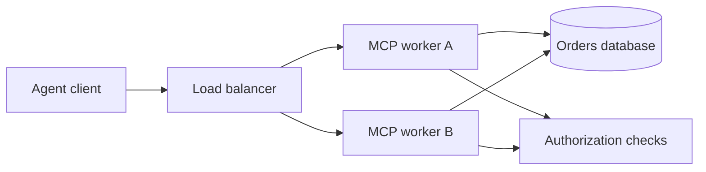

# The Business Case for Stateless MCP

A single order lookup can serve a support team, a customer's AI assistant, and a fulfillment partner. For the company providing that tool, each connection makes an existing service available in another workflow.

Once customers depend on that tool, its availability becomes part of the product. A failed lookup can interrupt a support conversation or hold up a fulfillment decision. The endpoint needs to handle demand and remain available as the team releases changes.

An MCP server can have several replicas and still need to send a client's next tool call back to one instance. If that worker holds the client's protocol session, another may be missing the context established when the client connected. A deployment, restart, or traffic spike now involves managing that dependency.

That work has a business cost: engineering time spent on session routing and recovery, infrastructure needed to support it, and release coordination around clients that are already connected.

**Stateless MCP removes the protocol session from that operating model.** A request carries its version and capabilities, allowing a worker to interpret the call without recovering context from an earlier connection. The `2026-07-28` revision also removes the initialization handshake. [MCP protocol changes](https://modelcontextprotocol.io/specification/2026-07-28/basic/versioning)

For a product team, this can remove work from the path between exposing a capability and operating it for customers.

## Stateful and stateless MCP servers

MCP, the Model Context Protocol, gives AI applications a way to discover tools, inspect their inputs, and invoke them. A tool can look up an order, search documentation, or calculate a metric. The client running the model handles the interaction with the server. [MCP tools specification](https://modelcontextprotocol.io/specification/2026-07-28/server/tools)

Earlier protocol revisions began with an initialization exchange. A client introduced itself and its capabilities, the server replied, and the client sent an initialized notification before normal operations began. On HTTP, a server could also issue an `Mcp-Session-Id` for subsequent requests.

The distinction matters: session IDs were optional in the older Streamable HTTP specification. Stateless server implementations existed before 2026. The new revision removes the initialization exchange and protocol-level sessions from the core model. [Earlier HTTP transport](https://modelcontextprotocol.io/specification/2025-06-18/basic/transports), [2026 versioning model](https://modelcontextprotocol.io/specification/2026-07-28/basic/versioning)

When a deployment did keep session information inside a worker, later calls needed access to that worker's state. Routing a client back to the same instance was one approach. Sharing the required state was another. Either approach added work to deployment, failover, and instance replacement.

For an order lookup that already gets its records from a database, that dependency can be difficult to justify. The handler needs the requested order and the caller's authority to read it. A prior transport session should not have to supply either.

## Engineering effort that can return to the product

For a product team, supporting an integration includes the work that follows its first successful tool call. Someone owns deployment, recovery, compatibility, and support when a customer reports a failure.

Removing protocol sessions can reduce the code and configuration that team needs to maintain around the tool. An endpoint whose workers do not retain client sessions can use familiar request-routing patterns. Engineers can spend less effort coordinating connection state and more on the operation customers need: an order lookup, a stock check, or a report.

The value is especially relevant to a platform team serving several product groups. A common deployment approach can be reused across tools instead of each group developing its own session-lifecycle handling. New tools still need business logic, authorization, and tests. The potential saving is in infrastructure and protocol work that would otherwise recur.

Teams already operating session-free services may see a smaller change. For teams maintaining session affinity or a protocol session store, there is a specific dependency to examine.

## How stateless MCP requests work

The `2026-07-28` revision lets a client send an operation without first opening a protocol session. The request declares its protocol version and capabilities in `_meta`; client name and version can travel there as well. [Request metadata](https://modelcontextprotocol.io/specification/2026-07-28/basic/index)

Suppose a server exposes a tool named `get_order_status`. A request could look like this:

```http
POST /mcp HTTP/1.1
Host: orders.example.com
Authorization: Bearer <access-token>
Content-Type: application/json
Accept: application/json, text/event-stream
MCP-Protocol-Version: 2026-07-28
Mcp-Method: tools/call
Mcp-Name: get_order_status

{
  "jsonrpc": "2.0",
  "id": "order-lookup-1",
  "method": "tools/call",
  "params": {
    "name": "get_order_status",
    "arguments": {
      "orderId": "ORD-1042"
    },
    "_meta": {
      "io.modelcontextprotocol/protocolVersion": "2026-07-28",
      "io.modelcontextprotocol/clientCapabilities": {},
      "io.modelcontextprotocol/clientInfo": {
        "name": "order-assistant",
        "version": "1.0.0"
      }
    }
  }
}
```

This is an illustrative request for that hypothetical tool, not a call to a running example service. The protocol version appears in both the HTTP header and body metadata. The method and tool name are mirrored into headers as specified by the HTTP binding. There is no session ID to retrieve first. [Streamable HTTP binding](https://modelcontextprotocol.io/specification/2026-07-28/basic/transports/streamable-http)

The server still has to authenticate the caller, validate the arguments, and check access to `ORD-1042`. The `clientInfo` name is useful for diagnostics, but it is self-reported metadata, not proof of identity. A client calling itself `order-assistant` has gained no permission to read an order. [Metadata and identity](https://modelcontextprotocol.io/specification/2026-07-28/basic/index)

If two workers share the same configuration and can reach the required data and authorization systems, either can handle the request. Restarting one worker no longer requires restoring an MCP session before the next lookup can proceed.



The database and authorization systems remain dependencies. This diagram removes the need to keep the client's protocol session inside a particular worker.

For the commerce platform, an increase in order lookups can be spread across eligible workers without first assigning each caller to a session owner. This creates room to adjust worker capacity around demand. The resulting cost depends on utilization, downstream capacity, and the deployment platform.

## Tool discovery and caching in stateless MCP

A client may already know the name and schema of the tool it wants to call. Another client may need to find out what the server offers.

`server/discover` returns the server's supported protocol versions and capabilities. A client can call it up front, but it is not a mandatory opening exchange. Tool definitions are available through `tools/list`. Removing the handshake leaves discovery available when it serves the task. [Server discovery](https://modelcontextprotocol.io/specification/2026-07-28/server/discover)

That gives an application several options. A general assistant can inspect the catalog. A purpose-built order assistant can work with a known contract. Both can use the same MCP endpoint.

The catalog becomes part of the integration experience. A partner can inspect the operation and its expected inputs before making a call. Authentication, supported features, and the meaning of those inputs still need to be checked during onboarding.

Catalog responses can also provide `ttlMs` and `cacheScope`, allowing a client to reuse a response within its declared lifetime and scope. A catalog that varies by user permissions needs that distinction: one user's cached tool list must not become another user's view of the server. [Tool listing and caching](https://modelcontextprotocol.io/specification/2026-07-28/server/tools)

An MCP cache hint does not make an ordinary CDN cache JSON-RPC POST requests automatically. A cache implementation still needs to understand the operation, authorization context, and invalidation rules. Discovery metadata and customer order results have different sharing requirements.

When many clients request the same eligible catalog information, reusing it can reduce repeated origin work. The saving should be measured alongside cache freshness and access scope.

## Application state, approvals, and retries

An order lookup is short. Exporting a year of orders might take minutes, and approving a refund may require a person to respond. Those workflows still need state.

The application can make that state explicit. An export operation might return a job handle. A later call supplies the handle, and whichever worker receives it looks up the job in shared storage. The handle identifies work that exists independently of a connection. The MCP release describes explicit handles as an alternative to hiding application state inside a transport session. [Release announcement](https://blog.modelcontextprotocol.io/posts/2026-07-28/)

An agent's conversation can remain in its host. Order records remain in the order system. Export progress can live in a job store. Removing protocol sessions gives these different kinds of state a chance to be designed around their own lifetimes.

Human input has a request-and-resume pattern too. With Multi Round-Trip Requests, a supported operation can return `resultType: "input_required"`, describe the input it needs, and optionally include an opaque `requestState`. The client obtains the input and retries the operation with `inputResponses` and the returned state. [Multi Round-Trip Requests](https://modelcontextprotocol.io/specification/2026-07-28/basic/patterns/mrtr)

For the refund example, the server could return a confirmation request instead of keeping a handler suspended while someone decides. A later request carries the response.

That separation matters in business workflows where the wait belongs to a person or a process. A manager may respond after a worker has been replaced. The approval should be tied to the operation and its recorded context, so another eligible worker can process the continuation.

That continuation needs protection. State sent through a client must be treated as untrusted. When it affects permissions or business behavior, verify its integrity and bind it to the intended caller and operation, with an expiry. An operation that must happen once also needs server-side enforcement. A signed continuation alone does not stop someone replaying it. [Continuation requirements](https://modelcontextprotocol.io/specification/2026-07-28/basic/patterns/mrtr)

The same issue appears when a tool writes data and the response is lost. A retry may repeat an operation that already succeeded. For a refund, use an application-level idempotency key or equivalent transactional protection. The JSON-RPC request ID correlates a request and response; it is not an application-level promise that a payment or refund happens once.

## Scaling stateless MCP servers

Once protocol session recovery is removed, an instance can be replaced without moving that session elsewhere. Fewer session dependencies can make releases easier to schedule and reduce recovery work. Request draining, dependency availability, and client retry behavior remain part of deployment design, so uninterrupted service still requires work. The improvement is a smaller set of things the team must coordinate to deliver a change.

The headers also make a request more visible to infrastructure. A gateway can distinguish a tool invocation from discovery, or route a named export tool to a different worker pool. It must not blindly trust that the headers describe the operation in the body: the HTTP binding requires validation of their agreement. [Header routing and validation](https://modelcontextprotocol.io/specification/2026-07-28/basic/transports/streamable-http)

Streaming remains available. A response can use a request-scoped SSE stream to deliver progress before its final result. Statelessness does not require every operation to return one JSON object immediately. [Response transport](https://modelcontextprotocol.io/specification/2026-07-28/basic/transports)

There are useful measurements to collect here: tool duration, dependency latency, rejected calls, failed operations, and retries. Together, they help distinguish time spent executing a tool from time spent waiting for its database or downstream API. None of these measurements establishes that an agent chose the correct tool; that still needs evaluation against the task.

Existing clients also need a migration path. A client that expects initialization and session behavior cannot be assumed to speak the new revision. Supporting both protocol generations can let a service migrate its clients over time. The old path retains its own behavior until those clients move. [Compatibility rules](https://modelcontextprotocol.io/specification/2026-07-28/basic/versioning)

That compatibility work has commercial value when customers control their own upgrade schedules. A provider can offer the new request model while maintaining a supported path for existing integrations, then retire the old path through its usual product lifecycle.

## What changes for the MCP ecosystem

An integration has two owners: the organization exposing a capability and the application using it. Protocol sessions add lifecycle behavior both sides must implement and troubleshoot. A request that carries its own context reduces that shared coordination.

Tool providers can concentrate on contracts, access policies, and service behavior. Client builders can invoke capabilities without establishing a new protocol session first. Infrastructure providers can use request metadata to route and meter operations.

MCP's shared contract makes a capability reusable across compatible applications. The stateless core reduces the session coordination needed to operate that capability. For a software provider, this makes an agent-facing endpoint another route for product adoption inside customer workflows. Commercial success still depends on whether the tool solves a problem customers will pay to address.

Consider the commerce example again. The company can expose the same authorized order-status operation to its own support assistant and to a customer's compatible AI client. The business logic can remain shared while identities, entitlements, and permitted data differ by caller. That requires deliberate application design, but the protocol no longer adds a session that must follow each caller between workers.

## Measure the business case against the existing service

A cost claim needs a baseline. For an existing MCP deployment, compare the work and resources required to deliver the same authorized operation before and after migration.

| Business question | Measure |
| --- | --- |
| Does the team spend less time operating the integration? | Engineering hours spent on session handling, deployment coordination, and related incidents |
| Can the service use capacity more effectively? | Worker utilization and infrastructure cost per successful business operation at comparable load |
| Does replacing a worker cause less disruption? | Failed operations, recovery time, and repeated work during controlled deployment tests |
| Is it easier to support another client? | Time to complete authentication, compatibility testing, and the first authorized operation |

Count completed business work, including the requests and retries needed to finish it. A refund recorded twice is a failure even if both HTTP requests succeeded. For services using paid model calls, include those costs separately from MCP server costs.

Use these measurements to decide whether the migration removes enough work to justify its implementation and compatibility costs. The business case will differ between an internal tool used by one team and a service exposed to many customer environments.

## Build a stateless MCP server with NitroStack

NitroStack lets a team define its tools, resources, and prompts in application modules and serve them through MCP. Its documented HTTP protocol modes include `2026-07-28`, legacy support, and an `auto` mode that accepts both generations. This gives a team a framework-supported path for exposing its business capabilities while migrating clients over time. [Protocol configuration](https://docs.nitrostack.ai/docs/getting-started/core-concepts/bootstrap#protocol-version)

For a TypeScript project using a NitroStack release that supports the new revision, the documented environment setting can select stateless MCP without changing the tool implementation:

```bash
MCP_TRANSPORT_TYPE=http \
NITRO_MCP_PROTOCOL_VERSION=2026-07-28 \
npm start
```

This command assumes an existing NitroStack project with its start script configured. `MCP_TRANSPORT_TYPE` chooses the listener; `NITRO_MCP_PROTOCOL_VERSION` chooses the protocol behavior. Setting the latter to `auto` supports migration alongside older clients. The environment setting takes precedence over the application's protocol configuration. [NitroStack HTTP transport configuration](https://docs.nitrostack.ai/docs/guides/dual-transport), [protocol selection and bootstrap options](https://docs.nitrostack.ai/docs/getting-started/core-concepts/bootstrap)

The request pipeline gives the application places to enforce its rules: guards control whether a call may proceed, pipes validate inputs, middleware can record execution, and the handler performs the work. For the order tool, the handler should obtain records through a service that applies the caller's access constraints. [Request lifecycle](https://docs.nitrostack.ai/docs/getting-started/core-concepts/request-lifecycle)

During development, NitroStudio's Health view shows the protocol revision and advertised capabilities. The HTTP health endpoint also provides transport information. These help check what a deployment is serving before debugging the tool itself. [Transport verification](https://docs.nitrostack.ai/docs/guides/verify-transport)

The business value is in concentrating protocol and request-pipeline work in the framework while the application team owns the capability customers use. Order records, permissions, job persistence, and protection against duplicate writes remain application responsibilities. With those dependencies available to each worker, the same order-status tool can serve a support workflow, a customer assistant, or a partner integration through an MCP interface.
